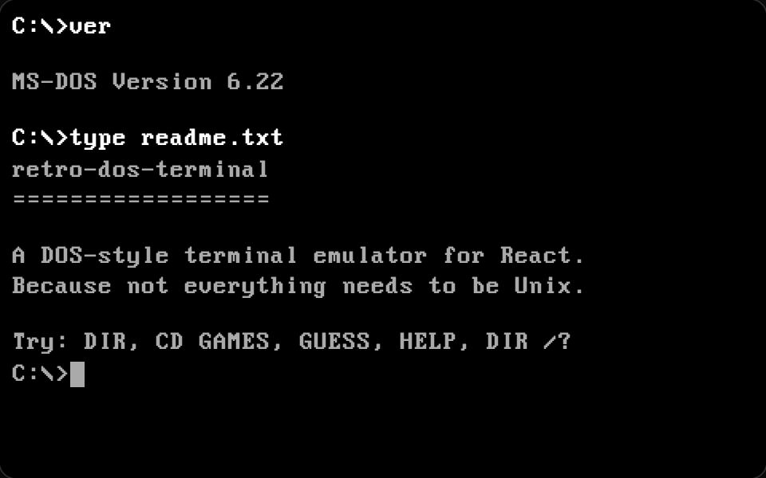
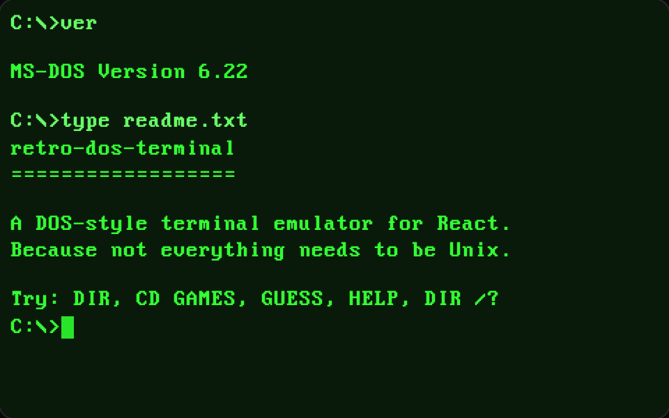
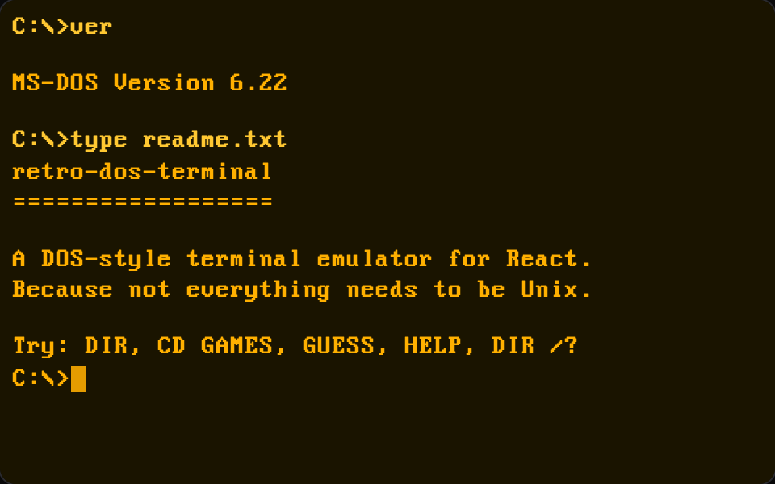
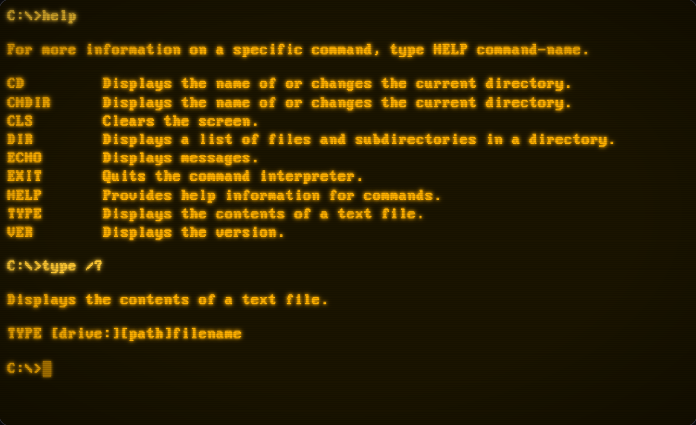
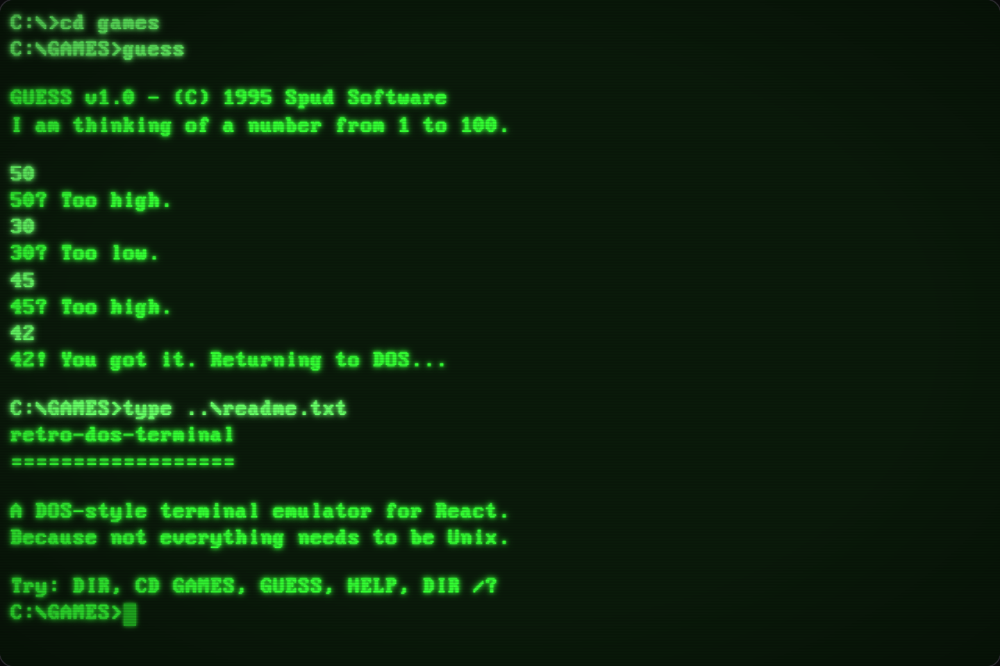
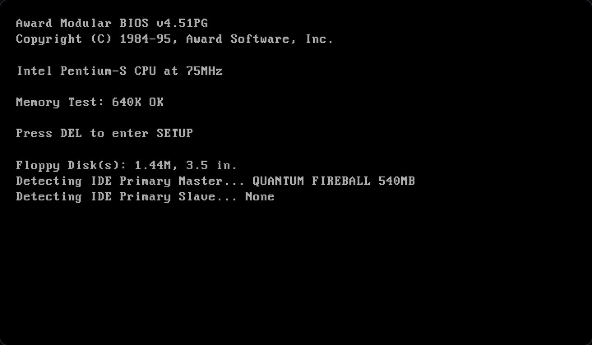

<div align="center">

# retro-dos-terminal

**A DOS-style terminal emulator for React.**<br>
Because not everything needs to be Unix.

[](https://github.com/introvertedspud/retro-dos-terminal/actions/workflows/ci.yml)
[](https://www.npmjs.com/package/retro-dos-terminal)
[](https://www.npmjs.com/package/retro-dos-terminal)
[](LICENSE)


</div>

## Features

- **Looks the part** - bundled VGA font, a block cursor that inverts the character under it, and authentic DOS 6.22 output
- **Real commands** - `DIR` (with `/W` and `/P`), `CD`, `TYPE`, `HELP`, `/?` usage, DOSKEY history, drive letters
- **Virtual filesystem** - describe folders and files as plain data
- **Interactive programs** - `.EXE` files that take over input, for games and easter eggs
- **Themes and CRT effects** - gray, green and amber phosphor, plus scanlines, glow, flicker and vignette
- **BIOS boot screen** - Award, AMI and Phoenix POST sequences
- **Plugin architecture** - every command is a plugin; write your own in a few lines
- **Small and typed** - TypeScript throughout, tree-shakeable, no runtime dependencies besides React

## Installation

```bash
npm install retro-dos-terminal
```

Requires React 18 or later.

## Quick Start

The DOS preset wires up the filesystem, DOSKEY, and every built-in command:

```tsx
import { DOSTerminal } from 'retro-dos-terminal/presets/dos'
import type { FileSystem } from 'retro-dos-terminal'
import 'retro-dos-terminal/styles.css'

const files: FileSystem = {
  'C:\\': [
    { type: 'folder', name: 'GAMES' },
    { type: 'file', name: 'README.TXT', size: 24, content: ['Welcome to my terminal!'] },
  ],
  'C:\\GAMES': [
    { type: 'file', name: 'SNAKE.EXE', size: 40960, executable: true },
  ],
}

function App() {
  return (
    <div style={{ height: 400 }}>
      <DOSTerminal
        filesystem={files}
        welcomeMessage={['Welcome to DOS Terminal', 'Type HELP for available commands.', '']}
        onExit={() => console.log('Goodbye!')}
      />
    </div>
  )
}
```

The terminal fills its parent's height, so give the parent a height.

## Building Your Own

For full control, use `Terminal` and pick the plugins you want. Memoize the plugins array (or define it outside the component); plugins are set up once on mount.

```tsx
import { useMemo } from 'react'
import { Terminal } from 'retro-dos-terminal'
import { filesystem } from 'retro-dos-terminal/plugins/filesystem'
import { doskey } from 'retro-dos-terminal/plugins/doskey'
import { cd, cls, dir, echo, help, type, ver } from 'retro-dos-terminal/plugins/commands'
import 'retro-dos-terminal/styles.css'

// `files` is a FileSystem object like the one in Quick Start
function App() {
  const plugins = useMemo(
    () => [filesystem({ files }), doskey(), cd(), cls(), dir(), echo(), help(), type(), ver()],
    []
  )
  return <Terminal theme="phosphor-green" plugins={plugins} />
}
```

## Themes

Three built-in themes:

<table>
  <tr>
    <td align="center"><br><code>dos</code></td>
    <td align="center"><br><code>phosphor-green</code></td>
    <td align="center"><br><code>phosphor-amber</code></td>
  </tr>
</table>

```tsx
// Classic DOS gray (default)
<Terminal theme="dos" />

// Green phosphor
<Terminal theme="phosphor-green" />

// Amber phosphor
<Terminal theme="phosphor-amber" />

// Custom theme - any field you omit falls back to the DOS default
<Terminal theme={{
  colors: {
    background: '#1a1a2e',
    text: '#00ff88',
    prompt: '#00ff88',
    command: '#ffffff',
  },
  cursor: { style: 'underline', blink: true },
  promptFormat: '{cwd}>',
  font: { size: '18px' },
}} />
```

Cursor styles: `'block'`, `'underline'`, `'line'`.

## Plugins

### Commands



Each command is its own plugin:

```tsx
import { cd, cls, dir, echo, exit, help, type, ver } from 'retro-dos-terminal/plugins/commands'

<Terminal plugins={[cls(), echo(), ver({ version: 'SpudOS Version 1.0' })]} />
```

| Command | Notes |
| --- | --- |
| `CD` / `CHDIR` | Needs filesystem. Supports `..`, `\`, absolute paths, `cd..`, and drive switching (`D:`) |
| `CLS` | Clears the screen |
| `DIR` | Needs filesystem. Supports `/W` (wide) and `/P` (pause per screen) |
| `ECHO` | Prints its arguments |
| `EXIT` | Calls the `onExit` prop |
| `HELP` | Lists installed commands. `HELP DIR` or `DIR /?` shows usage |
| `TYPE` | Needs filesystem. Prints a file's `content` |
| `VER` | Prints the version string |

Options: `dir({ pageSize: 23 })` sets lines per screen for `/P`, and `help({ descriptions, usage })` documents your own commands:

```tsx
help({
  descriptions: { date: 'Displays the date.' },
  usage: { date: ['Displays the date.', '', 'DATE'] },
})
```

### Filesystem

A virtual filesystem keyed by directory path. Each directory maps to a list of its entries:

```tsx
import { filesystem } from 'retro-dos-terminal/plugins/filesystem'

const files = {
  'C:\\': [
    { type: 'file', name: 'AUTOEXEC.BAT', size: 10, content: ['@ECHO OFF'] },
    { type: 'folder', name: 'DOS' },
  ],
  'C:\\DOS': [
    { type: 'file', name: 'COMMAND.COM', size: 54645, modified: new Date(1994, 4, 31) },
  ],
}

<Terminal plugins={[filesystem({ files })]} />
```

Paths are case-insensitive. Other plugins can read it with `ctx.get<FilesystemAPI>('filesystem')`.

### DOSKEY

Command history with the up/down arrow keys:

```tsx
import { doskey } from 'retro-dos-terminal/plugins/doskey'

<Terminal plugins={[doskey({ maxHistory: 50 })]} />
```

### CRT Effects

Retro CRT monitor effects:

```tsx
import { crt } from 'retro-dos-terminal/plugins/effects'
import 'retro-dos-terminal/plugins/effects/styles.css'

<Terminal plugins={[crt({
  scanlines: true,
  scanlineOpacity: 0.1,
  glow: true,
  glowIntensity: 0.4,
  glowColor: '#33ff33', // defaults to the text color
  flicker: false,
  curvature: true, // edge vignette
})]} />
```

Flicker is disabled automatically for users who prefer reduced motion.

### Programs



Interactive programs take over input until they exit. A program only runs when a matching executable exists in the current directory of the filesystem.

```tsx
import { programs, defineProgram } from 'retro-dos-terminal/plugins/programs'

const hello = defineProgram({
  commands: ['hello', 'hello.exe'],
  onStart: (ctx) => ctx.print('Hello! Type EXIT to quit.'),
  onInput: (input, ctx) => {
    if (input.toLowerCase() === 'exit') {
      ctx.get<() => void>('exitProgram')?.()
      return { handled: true }
    }
    ctx.print(`You said: ${input}`)
    return { handled: true }
  },
  // Optional: return true to consume a key (e.g. arrows for a game)
  onKeyDown: (key, ctx) => false,
})

const files = {
  'C:\\': [{ type: 'file', name: 'HELLO.EXE', executable: true }],
}

<Terminal plugins={[filesystem({ files }), programs([hello])]} />
```

### Writing a Plugin

```tsx
import type { TerminalPlugin } from 'retro-dos-terminal'

const date: TerminalPlugin = {
  name: 'date',
  commands: {
    date: (args, ctx) => ({ output: [`Current date is ${new Date().toDateString()}`] }),
  },
}
```

Plugins can also define:

- `setup` / `cleanup` - run on mount and unmount
- `beforeCommand` / `afterCommand` - middleware around every command
- `onKeyDown` - intercept keys (return `true` to consume)
- `render` - draw overlays above the terminal
- `cssVariables` - CSS custom properties set on the terminal root

Use `ctx.get` / `ctx.set` to share state between plugins, and `ctx.commands` to see what's installed.

## BIOS Boot Screen



Optional retro BIOS POST screen:

```tsx
import { BIOSBoot } from 'retro-dos-terminal/boot'

<BIOSBoot
  preset="award"  // 'award', 'ami', or 'phoenix'
  speed="fast"    // 'instant', 'fast', or 'authentic'
  onComplete={() => console.log('Boot complete!')}
>
  <DOSTerminal filesystem={files} />
</BIOSBoot>

// Custom BIOS configuration, contained in its parent
<BIOSBoot
  biosName="MyOS BIOS"
  biosVersion="v1.0"
  cpu="Intel Pentium 133MHz"
  memory={640}
  drives={{ primaryMaster: 'QUANTUM FIREBALL 540MB' }}
  fullscreen={false}
>
  <DOSTerminal filesystem={files} />
</BIOSBoot>
```

## Imperative Handle

Control the terminal programmatically:

```tsx
import { useRef } from 'react'
import { Terminal, type TerminalHandle } from 'retro-dos-terminal'

function App() {
  const terminalRef = useRef<TerminalHandle>(null)

  const runCommand = () => {
    terminalRef.current?.executeCommand('DIR')
  }

  return (
    <>
      <button onClick={runCommand}>Run DIR</button>
      <Terminal ref={terminalRef} />
    </>
  )
}
```

Available methods:
- `print(text)` - Print output lines
- `printError(text)` - Print error lines
- `clear()` - Clear the screen
- `focus()` - Focus the input
- `executeCommand(cmd)` - Execute a command

## DOS Preset Props

| Prop | Default | Description |
| --- | --- | --- |
| `filesystem` | none | Virtual filesystem |
| `theme` | `'dos'` | Preset name or custom theme |
| `initialCwd` | `'C:\\'` | Starting directory |
| `welcomeMessage` | none | Lines shown on mount |
| `version` | `'MS-DOS Version 6.22'` | `VER` output |
| `maxHistory` | `50` | DOSKEY history size |
| `maxHistoryLines` | `1000` | Display lines kept (`0` = unlimited) |
| `onExit` | none | Called by `EXIT` |
| `className` | none | Extra CSS class |

## TypeScript

Full TypeScript support with exported types:

```tsx
import type {
  TerminalProps,
  TerminalHandle,
  TerminalPlugin,
  TerminalContext,
  TerminalProgram,
  CommandHandler,
  CommandResult,
  PartialTheme,
  FileNode,
  FileSystem,
} from 'retro-dos-terminal'
```

## Development

```bash
npm install
npm test          # Vitest + Testing Library
npm run typecheck
npm run build     # tsdown -> dist/
npm run screenshots  # regenerate docs/images (needs Chrome and ffmpeg)
```

The README images are captured from the real components in [`docs/showcase`](docs/showcase).

## Browser Support

Works in all modern browsers. The bundled DOS VGA font provides authentic rendering.

## License

MIT
